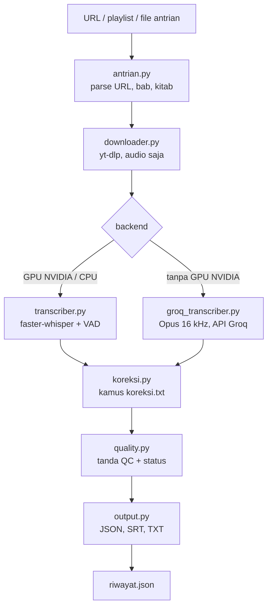

# Arsitektur

## Alur data



Satu video diproses berurutan: **unduh -> transkripsi -> koreksi kamus -> tanda QC -> simpan -> catat riwayat**.
Kegagalan satu video dicatat (`status: gagal`) dan tidak menghentikan video lain.

## Modul

| File | Tanggung jawab |
|---|---|
| `run.py` | Titik masuk (CLI), `process()` (loop video), kunci proses ganda, normalisasi path riwayat |
| `antrian.py` | Membaca file antrian (`# bab:`, `# kitab:`), membersihkan URL, mengambil ID video, mendeteksi playlist |
| `downloader.py` | Mengunduh audio (yt-dlp), cache `audio\<id>.m4a` + `<id>.info.json`, menolak video live |
| `transcriber.py` | Whisper lokal (faster-whisper); VAD aktif/mati; kompatibilitas PyAV 19 |
| `groq_transcriber.py` | Whisper lewat Groq API: kompres Opus, potong, kirim, gabung segmen |
| `koreksi.py` | Menerapkan `koreksi.txt` ke teks segmen; juga perintah untuk hasil lama |
| `quality.py` | Tanda QC per segmen dan status per video |
| `output.py` | Menulis JSON/SRT/TXT, membaca/menulis `riwayat.json` (atomic, retry saat terkunci) |
| `models.py` | Mengunduh model Whisper dengan progress bar, cek kelengkapan cache |
| `config.py` | Semua pengaturan dari `.env`; fungsi pembaca teks/JSON yang tahan BOM |
| `gpu_setup.py` | Mendaftarkan DLL CUDA (cuBLAS/cuDNN dari pip) di Windows |
| `check_gpu.py` | Diagnosis kesiapan GPU NVIDIA |
| `eval_test.py` | Test suite (tanpa GPU/internet) |

## Format keluaran

Setiap video menghasilkan tiga file di `hasil\<Bab>\`, dengan nama
`<tanggal-upload>_<id-video>_<judul-dipotong>.{json,srt,txt}`.

### JSON (untuk pipeline / RAG)

```json
{
  "video": {
    "video_id": "hHn8Od5_oqs",
    "judul": "01. KARYA YANG MENGUBAH DUNIA | Riyaadhushshaalihiin",
    "channel": "...", "tanggal_upload": "20200410", "durasi_detik": 2343,
    "url": "https://youtu.be/hHn8Od5_oqs", "bab": "Niat", "kitab": "Riyadhussalihiin"
  },
  "transkripsi": {
    "durasi_audio": 2342.5, "waktu_proses": 51.0, "kecepatan_x_realtime": 46.0,
    "model": "groq/whisper-large-v3", "device": "groq", "compute_type": "api",
    "prompt": "<contoh gaya + glosarium yang dikirim ke model>",
    "koreksi_otomatis": 0
  },
  "kualitas": {
    "status": "PERLU_CEK", "total_segmen": 265, "segmen_ditandai": 8,
    "persen_ditandai": 3.0, "per_tanda": {"TERLEWAT": 6, "MIRIP_PROMPT": 2}, "durasi_detik": 2342.5
  },
  "diproses_pada": "2026-10-19T14:02:11",
  "segments": [
    {
      "id": 0, "start": 7.2, "end": 13.1, "text": "...",
      "avg_logprob": -0.21, "no_speech_prob": 0.01, "compression_ratio": 1.4,
      "flags": [], "link": "https://youtu.be/hHn8Od5_oqs?t=7",
      "revisi": [{"lama": "al-Dhahabi", "baru": "adz-Dzahabi", "alasan": "...", "oleh": "koreksi.txt"}]
    }
  ]
}
```

Catatan:

- `transkripsi.vad` (`true`/`false`) hanya ada pada backend lokal; contoh di atas berasal dari Groq sehingga
  kuncinya tidak muncul.
- `revisi` hanya muncul pada segmen yang diubah kamus koreksi. `words` (timestamp per kata) hanya ada
  bila memakai `--words`.
- `link` lompat langsung ke detik segmen, untuk sitasi jawaban bot.
- **Granularitas segmen berbeda antar backend**: lokal ±30-45 detik per segmen, Groq ±6-8 detik.
  Pipeline hilir (mis. chunker RAG) sebaiknya tidak mengasumsikan panjang segmen tertentu.

### SRT dan TXT

SRT untuk dicek di pemutar video. TXT untuk dibaca cepat: tiap baris diawali `[mm:ss]`, dan segmen
bertanda diberi `⚠ TANDA1,TANDA2` di belakangnya.

## riwayat.json

Peta `id-video -> entri`. Dipakai untuk melewati video yang sudah selesai dan untuk membersihkan
file lama saat `--force`.

```json
{
  "hHn8Od5_oqs": {
    "bab": "Niat", "kitab": "Riyadhussalihiin", "diproses_pada": "2026-10-19T14:02:11",
    "status": "selesai", "judul": "...", "model": "groq/whisper-large-v3", "kualitas": "PERLU_CEK",
    "file": {"json": "Niat/<nama>.json", "srt": "Niat/<nama>.srt", "txt": "Niat/<nama>.txt"}
  }
}
```

- Path file disimpan **relatif terhadap `hasil\`** (`<bab>/<file>`), jadi tetap valid saat folder dipindah
  atau repo di-clone di PC/OS lain. Path format lama (absolut) dimigrasi otomatis saat dimuat; hanya pola
  `.../hasil/<bab>/<file>` yang dipetakan, path lain dibiarkan dan tidak pernah dihapus.
- `status: gagal` menyimpan `error` (API key disamarkan `***`) dan `file_sebelumnya` bila ada hasil lama.
- Penulisan **atomic** (tulis `.tmp` lalu ganti) dan dicoba ulang bila file terkunci sementara
  (OneDrive/antivirus). File rusak dipindah ke `riwayat.rusak-<waktu>.json`, entri bukan objek dibuang
  setelah file aslinya disalin.

## Keputusan desain

| Keputusan | Alasan |
|---|---|
| Hanya audio yang diunduh, tanpa konversi | faster-whisper membaca m4a/webm lewat PyAV; ffmpeg tidak wajib |
| Bahasa dikunci `id` + contoh gaya Arab-Latin di prompt | Tanpa itu, model berhenti menulis saat ustadz membaca bahasa Arab |
| Koreksi kamus berjalan **sebelum** tanda QC | Tanda dihitung pada teks yang sudah benar; perubahan tercatat di `revisi` |
| Koreksi hanya untuk kesalahan yang *selalu* salah | Nama penceramah yang bocor bergantung konteks (siapa yang dikutip), jadi hanya ditandai (`NAMA_BOCOR`) |
| Kunci proses (`.run.lock`) | Dua proses menulis `riwayat.json` bersamaan akan saling menimpa |
| Hasil lama tidak dihapus di luar `hasil\` | `riwayat.json` bisa berasal dari PC lain; cleanup hanya menyentuh `hasil\` |
| Backend `auto`: GPU -> Groq -> CPU | Memakai yang tercepat/termurah yang tersedia tanpa konfigurasi |
